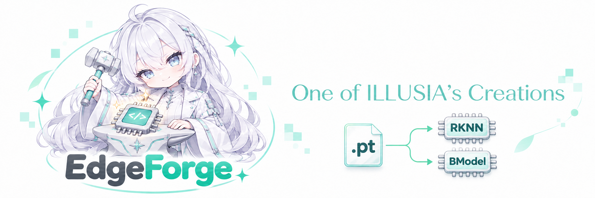
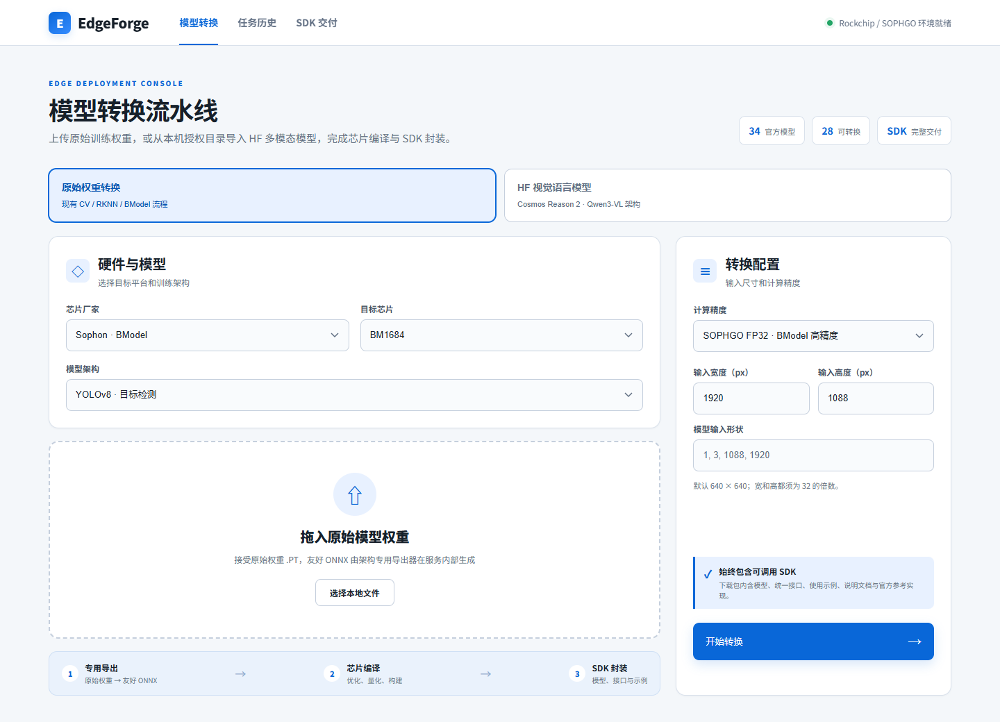
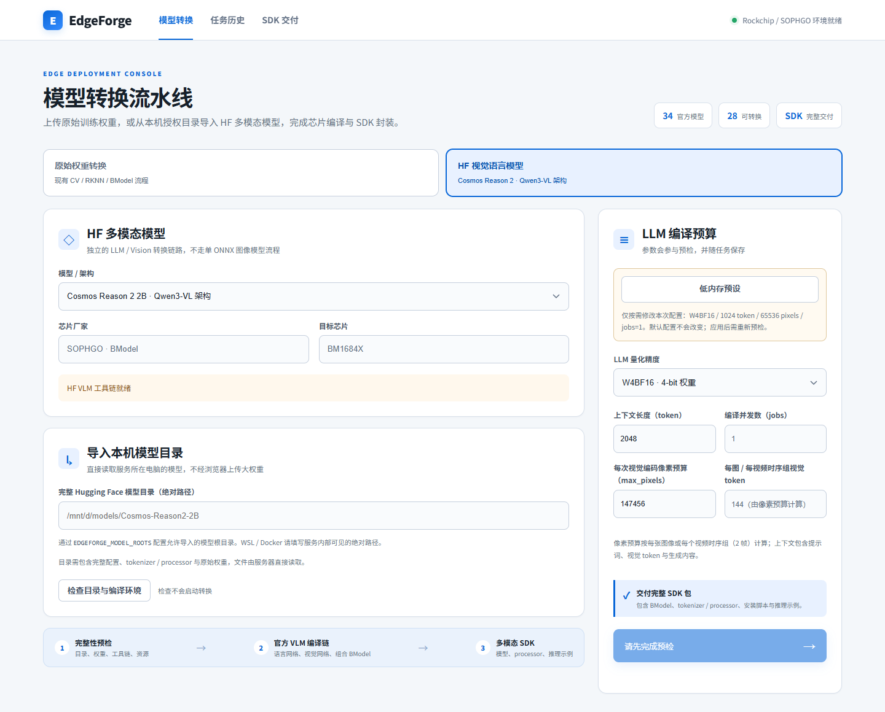
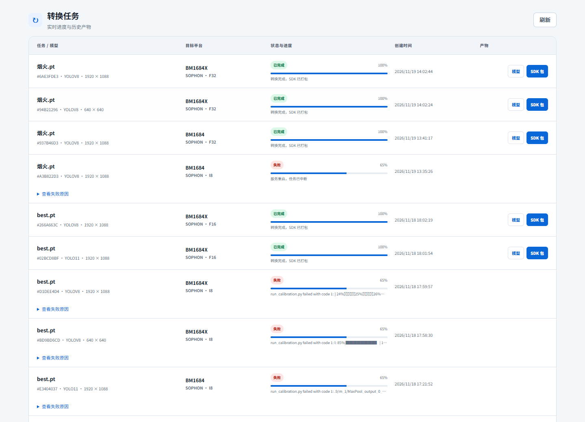
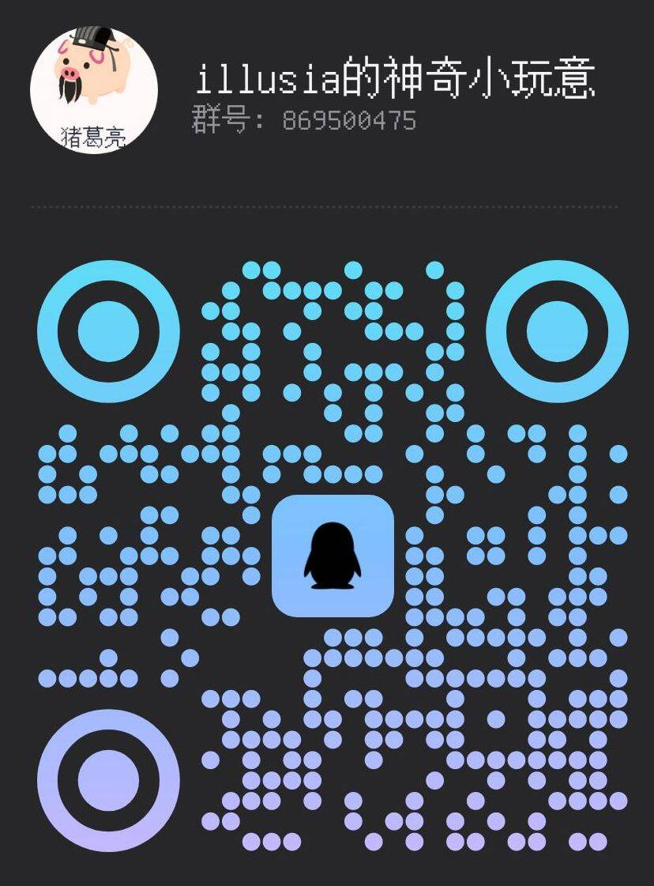

<a id="readme-top"></a>

<div align="center">
  <p></p>
  <h1>EdgeForge</h1>
  <p><strong>从训练权重到边缘部署，转换模型，也交付调用它的 SDK。</strong></p>
  <p>A self-hosted model conversion workbench for Rockchip RKNN and Sophon BModel.</p>
  <p>
    <a href="https://github.com/EchoSixHIYA/edgeforge-model-converter/actions/workflows/lightweight-ci.yml"></a>
    
    
    <a href="./sdk_template/SDK_README.md"></a>
    <a href="./LICENSE"></a>
  </p>
  <p>
    <a href="#screenshots">实机截图</a> · <a href="#quick-start">快速部署</a> · <a href="#models">模型与精度</a> · <a href="#sdk">SDK 使用</a> · <a href="#api">API</a> · <a href="#documentation">文档</a> · <a href="#community">社区</a> · <a href="https://github.com/EchoSixHIYA/edgeforge-model-converter/issues">反馈</a>
  </p>
</div>

## 关于 EdgeForge · Overview

EdgeForge 把模型导出、芯片编译和部署 SDK 放进同一个网页工作台。选择芯片厂家、目标芯片和模型架构，上传训练得到的 `.pt`、`.pth` 等原始权重，服务会调用对应架构的专用导出器，生成厂商友好的 ONNX，再编译为 RKNN 或 BModel。

下载的不只是模型文件：每个成功任务都包含模型配置、Python SDK、安装脚本、使用示例与官方参考代码。部署端选择对应的模型类，就能完成预处理、推理、后处理和结果绘制。

```text
原始训练权重 → 架构专用导出器 → 友好 ONNX → RKNN / BModel → 模型 + Python SDK
```

| 能力 · Capability | 说明 · Highlights |
| --- | --- |
| ◇ 多厂家转换 | Rockchip → RKNN，Sophon → BModel；按厂家展示可用架构、芯片和精度 |
| ↔ 自定义输入 | 支持的 YOLO 链路可设置宽高，方形和矩形均可；尺寸贯穿导出、编译与 SDK |
| ⚙ 浮点与 INT8 | 默认优先浮点；INT8 手动选择，自动使用内置校准样本，无需上传校准集 |
| ↻ 实时任务 | 串行转换、阶段进度、任务历史与模型 / SDK 下载 |
| 🧩 统一 SDK | 显式架构类，统一 `load / predict / preprocess / infer_raw / postprocess / draw` 接口 |
| 🖼 视觉语言模型 | Cosmos Reason 2 2B 使用独立的本地 HF 目录 → BM1684X 转换链路 |

<a id="screenshots"></a>

## 实机截图 · Screenshots

以下截图来自本机 WSL2 中实际运行的转换工作台。

### Rockchip · RKNN

选择 RK3588、YOLOv8 和浮点精度，输入尺寸可设为 `1920 × 1088`。


<details>
<summary>查看更多：算能转换、多模态模型与历史产物</summary>

### Sophon · BModel

BM1684 的 FP32 转换配置，同样支持自定义模型输入尺寸。



### HF 视觉语言模型

Cosmos Reason 2 的本地目录导入、编译预算与环境检查入口。



### 转换历史与 SDK 下载

已有任务的实际状态、转换进度和模型 / SDK 下载入口。



</details>

<a id="quick-start"></a>

## 快速部署 · Quick start

推荐在 **WSL2 Ubuntu 22.04 / Linux x86_64 + Python 3.10** 中运行转换服务，在目标板上运行生成的 SDK。

### 启动已有环境

在项目目录中运行：

```bash
bash scripts/start_dev_wsl.sh
```

打开 **[http://localhost:5000](http://localhost:5000)**。Windows 宿主机可通过 WSL 的 localhost 转发访问工作台；环境检查为 [`/health`](http://localhost:5000/health)。

当前 Windows 项目目录的 PowerShell 启动示例：

```powershell
wsl -d Ubuntu-22.04 -- bash -lc "cd '/mnt/e/边缘部署/模型转换服务器' && bash scripts/start_dev_wsl.sh"
```

前台启动时按 `Ctrl+C` 停止服务。项目不自动注册开机自启，也不会在启动时提交转换任务。

<details>
<summary>首次安装 · First-time setup</summary>

在 WSL / Ubuntu 中准备 Python 虚拟环境和构建工具：

```bash
sudo apt update
sudo apt install -y git python3.10-venv python3-pip build-essential cmake parallel

git clone https://github.com/EchoSixHIYA/edgeforge-model-converter.git
cd edgeforge-model-converter
mkdir -p wheels
```

从 [RKNN-Toolkit2 官方仓库](https://github.com/airockchip/rknn-toolkit2) 获取与 **Linux x86_64 / CPython 3.10** 匹配的 wheel，放入 `wheels/`，然后执行：

```bash
bash scripts/setup_wsl.sh
```

脚本安装主服务依赖，并准备模型专用仓库、CPU PyTorch 和独立的 Paddle / TensorFlow 等导出环境。Rockchip 路径当前使用 RKNN-Toolkit2 **2.3.2**。

需要算能 CV 转换时，再安装独立 TPU-MLIR 环境：

```bash
bash scripts/setup_sophon.sh
```

该脚本安装 TPU-MLIR **1.28.1** 并准备 `vendor/sophon-demo`。转换机不需要连接板卡；部署端运行 BModel 时才需要 SOPHON-SAIL。

Cosmos 的编译依赖单独安装，见 [Cosmos 本地转换指南](./docs/cosmos_reason2.md)。

</details>

### 完成第一次转换

1. 选择 **芯片厂家 → 目标芯片 → 模型架构**。
2. 上传该架构训练得到的原始权重，不需要提前导出 ONNX。
3. 设置输入尺寸和精度，点击 **开始转换**。
4. 在任务历史中查看进度，完成后下载 **模型** 或 **SDK 包**。
5. 把 SDK 解压到对应目标板，执行 `bash install.sh` 和示例程序。

转换任务按队列串行执行，网页、进度与下载可同时访问。

<a id="models"></a>

## 模型与精度 · Models & precision

### 模型目录

| 类型 | 已接入的模型系列 |
| --- | --- |
| 目标检测 | YOLOv5 / v6 / v7 / v8 / v9 / v10 / YOLO11 / v12、YOLOX、PP-YOLOE |
| 分割与姿态 | YOLOv5 Seg、YOLOv8 Seg / Pose / OBB、YOLOv9 Seg、YOLO11 OBB、PP-LiteSeg、DeepLabV3+、MobileSAM |
| 分类、OCR 与人脸 | MobileNet V2、ResNet-50、YOLOv8 Cls、LPRNet、PP-OCRv4、RetinaFace |
| 音频与图文 | YAMNet、CLIP、YOLO-World V2 |
| 视觉语言生成 | Cosmos Reason 2 2B / Qwen3-VL → BM1684X |

各厂家的可用模型并不完全相同。工作台按当前选择筛选；机器可读的架构、权重格式、芯片和精度清单位于 **[`GET /api/catalog`](http://localhost:5000/api/catalog)**。

### 精度选择

| 目标平台 | 工作台精度 | 默认选择 |
| --- | --- | --- |
| Rockchip | 浮点 `fp`，适用芯片上的 INT8 `i8` | 浮点 |
| Sophon BM1684 | FP32 `f32`、适用架构的 INT8 `i8` | FP32 |
| Sophon BM1684X | FP32 `f32`、FP16 `f16`、适用架构的 INT8 `i8` | FP32 |

切换模型或芯片后，工作台会重新优先选择浮点。**INT8 始终由用户手动选择**，服务器自动使用 RKNN Model Zoo 内置的 **20 张 COCO 图片**进行校准。需要文本、提示点或音频等额外输入的模型，不套用这份图像校准清单。

### 输入尺寸

支持自定义尺寸的 YOLO 架构可以分别填写宽、高，例如 **640 × 384** 或 **1920 × 1088**；两者均须为 **32 的倍数**。

这是模型张量尺寸，不是原图的尺寸限制。SDK 可以接收 `1920 × 1080` 等原始图像，自动缩放、补边，并把结果映射回原图。转换后会检查 ONNX 的实际输入形状，与请求不一致时在编译前报出差异。

SDK 配置中的 `input_size` 顺序是 `[宽, 高]`，ONNX 输入为 `[1, 3, 高, 宽]`。更改输入尺寸时重新转换并替换模型包即可。

<a id="sdk"></a>

## 下载即用的 SDK · Model SDK

CV 转换包的主要内容：

```text
sdk.zip
├─ edgeforge_sdk/      Python SDK 本体
├─ model/              RKNN / BModel、config.json 和中间 ONNX
├─ example.py          直接调用 SDK 的使用示例
├─ install.sh          虚拟环境与依赖安装
├─ SDK_README.md       安装、接口和返回值说明
├─ pyproject.toml      SDK 安装定义
├─ manifest.json       架构、芯片、精度和构建信息
└─ reference/          官方参考实现
```

在目标板解压后运行：

```bash
bash install.sh
.venv/bin/python example.py
```

若当前已激活虚拟环境，安装脚本会使用当前环境；否则在 SDK 目录创建 `.venv`。RKNN 包附带 RKNN-Toolkit-Lite2 的 aarch64 wheel；BModel 包使用板端已安装的 SOPHON-SAIL。

业务代码也可以直接调用：

```python
from edgeforge_sdk import YoloV8

with YoloV8("model") as model:
    detections = model.predict("test.jpg", confidence=0.25, iou=0.45)
    print([item.as_dict() for item in detections])
    model.draw("test.jpg", detections, "result.jpg")
```

安装 SDK 后，后续可单独替换 `model/`。不同架构使用对应的显式类，例如 `Yolo11`、`LPRNet`、`PPOCR` 或 `YAMNet`；`reference/` 不参与主调用流程。

完整说明：[SDK 使用指南](./sdk_template/SDK_README.md) · [SDK API](./转换接入文档/SDK_API.md)。

## HF 多模态转换 · Vision-language models

Cosmos Reason 2 2B 使用独立的 **本地 HF 目录 → TPU-MLIR 多图编译 → BM1684X BModel → Cosmos SDK** 路径，不走普通图像模型的单 ONNX 转换。

在 **HF 视觉语言模型** 标签页中填写服务可见的模型目录，预检通过后开始转换。完整原始 safetensors、tokenizer 和 processor 保留在本机，无需通过浏览器上传大权重。

- 使用 `EDGEFORGE_MODEL_ROOTS` 指定允许导入的模型根目录。
- 使用 `EDGEFORGE_LLM_PYTHON` 指定独立的 Python 3.10 编译环境。
- 支持上下文、视觉预算和量化精度设置；目录导入和任务操作限本机访问。
- 板端图片、文字、视频网页推理服务位于 [`deploy/cosmos_service`](./deploy/cosmos_service/README.md)，手动启动，不注册开机自启。

安装、参数与完整调用示例见 [Cosmos 本地转换指南](./docs/cosmos_reason2.md)。

<a id="api"></a>

## API

| 接口 | 用途 |
| --- | --- |
| `GET /health` | 检查转换工具链 |
| `GET /api/catalog` | 查询厂家、模型、芯片和精度 |
| `POST /api/tasks` | 上传原始权重并创建转换任务 |
| `GET /api/tasks` | 查询任务历史 |
| `GET /api/tasks/:id` | 查询单个任务 |
| `GET /api/tasks/:id/events` | SSE 阶段进度 |
| `GET /api/tasks/:id/download/model` | 下载模型 |
| `GET /api/tasks/:id/download/package` | 下载完整 SDK |

例如，在有 `best.pt` 的目录中创建一个 BM1684 FP32 任务：

```bash
curl -sS http://localhost:5000/api/tasks \
  -F "vendor=sophon" -F "architecture=yolov8" \
  -F "platform=bm1684" -F "precision=f32" \
  -F "input_width=1920" -F "input_height=1088" \
  -F "model=@best.pt"
```

返回 HTTP `202` 和任务 `id`，随后通过任务状态或 SSE 查询进度。厂商后端由 `vendor` 自动选择，不需要单独传入。

HF 模型使用独立的 `/api/vlm/preflight`、`/api/vlm/tasks` 和本地请求头，详见 [VLM JSON API](./docs/cosmos_reason2.md#json-api)。

## 数据与配置 · Configuration

`scripts/start_dev_wsl.sh` 会读取本机 `data/dev.env`。这是被 Git 忽略的本地配置，使用 Bash 的 `export 名称=值` 语法。

| 配置项 | 用途 |
| --- | --- |
| `PORT` | Web 端口，默认 `5000` |
| `VENV_DIR` | Web / RKNN 虚拟环境 |
| `SOPHON_VENV` | TPU-MLIR CV 编译环境 |
| `EDGEFORGE_DATA_DIR` | 任务、上传权重与转换产物目录 |
| `EDGEFORGE_MODEL_ROOTS` | HF 本地导入的模型根目录 |
| `EDGEFORGE_LLM_PYTHON` | Cosmos 独立编译环境的 Python |

默认任务目录为 `/home/<用户>/.edgeforge-model-converter-dev/tasks`。SDK 中的芯片型号必须与部署板一致。服务按本机或可信局域网使用，不直接暴露公网；Gunicorn 保持 **1 个 worker**，避免多个进程各自维护任务队列。

<a id="documentation"></a>

## 文档 · Documentation

| 我想要…… | 入口 |
| --- | --- |
| 调用生成的模型包 | [SDK 使用指南](./sdk_template/SDK_README.md) · [SDK API](./转换接入文档/SDK_API.md) |
| 接入新的模型仓库 | [模型仓库接入指南](./转换接入文档/MODEL_REPOSITORY_INTEGRATION.md) |
| 了解算能转换链路 | [SOPHGO 接入说明](./转换接入文档/SOPHGO_BM1684X.md) |
| 转换 Cosmos 多模态模型 | [Cosmos 本地转换指南](./docs/cosmos_reason2.md) |
| 部署 Cosmos 板端网页 / API | [Cosmos 推理服务](./deploy/cosmos_service/README.md) |
| 运行测试与检查 | [测试与验收说明](./docs/testing.md) |

<details>
<summary>开发与扩展 · Development</summary>

```text
server/catalog.py       厂家、架构、芯片与精度目录
server/exporters.py     原始权重 → 厂商友好 ONNX
server/backends/        RKNN / BModel 编译后端
server/pipeline.py      导出、校验、编译与 SDK 打包
server/tasks.py         串行队列与任务持久化
sdk_template/          下载 SDK 的模板与运行代码
templates/ + static/    网页工作台
```

新增厂商在 `server/backends/` 实现 `ConversionBackend` 并注册；新增模型按接入指南补齐专用导出器、元数据和 SDK 后处理。

轻量测试不需要板卡或完整编译器：

```bash
python3.10 -m venv .venv-test
.venv-test/bin/python -m pip install -r requirements-test.txt
.venv-test/bin/python -m pytest -q -ra
```

有 Node.js 时可单独检查前端逻辑：

```bash
node tests/ui/cv_precision_unit.cjs
node tests/ui/vlm_dom_unit.cjs
```

</details>

## 上游项目 · Upstream

- [RKNN Model Zoo](https://github.com/airockchip/rknn_model_zoo)：模型目录、部署示例与内置 COCO 样本。
- [RKNN-Toolkit2](https://github.com/airockchip/rknn-toolkit2)：Rockchip 模型编译与运行工具。
- [Sophon Demo](https://github.com/sophgo/sophon-demo)：算能模型示例、导出和编译参考。
- [TPU-MLIR](https://github.com/sophgo/tpu-mlir)：BModel 编译与量化工具链。
- [LLM-TPU](https://github.com/sophgo/LLM-TPU)：Qwen3-VL 等多模态模型的运行参考。

第三方模型、编译器和运行库保留各自的许可与使用条件。

<a id="community"></a>

## 社区 · Community

[GitHub Issues](https://github.com/EchoSixHIYA/edgeforge-model-converter/issues) · [QQ 群 · QQ group `869500475`](http://qm.qq.com/cgi-bin/qm/qr?_wv=1027&k=yhumUMDD9PmyYFWdXWUb_x7hM5trFQY8&authKey=Pw3HBGT7GwMinTQnuFGfnpf0aRSzXOJKcAiujVP1%2BXMpjheAKrncTRivicBJxpjV&noverify=0&group_code=869500475) · [Telegram](https://t.me/+8qShpTcuN9A3MWY9)

<p align="center"><a href="http://qm.qq.com/cgi-bin/qm/qr?_wv=1027&amp;k=yhumUMDD9PmyYFWdXWUb_x7hM5trFQY8&amp;authKey=Pw3HBGT7GwMinTQnuFGfnpf0aRSzXOJKcAiujVP1%2BXMpjheAKrncTRivicBJxpjV&amp;noverify=0&amp;group_code=869500475"></a></p>

## 许可证 · License

EdgeForge 自有代码及 SDK 使用 [GNU Affero General Public License v3.0（AGPL-3.0-only）](./LICENSE)。下载 SDK 时随包附带许可证；第三方模型、官方参考代码、编译器及运行库仍遵循各自的许可证。

<p align="right"><a href="#readme-top">返回顶部 · Back to top ↑</a></p>
